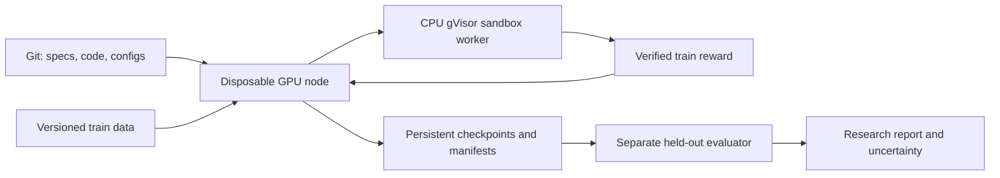

# Python Fixer: Code Repair with LLM Post-Training

A research project testing whether SFT and execution-reward GRPO improve
**Qwen3-0.6B** on held-out Python function repair. Optional Qwen3-1.7B scaling
comes after the primary study. The portfolio targets ML engineering / 大模型后训练:
data provenance, real training, verifiable rewards, reproducible evaluation and
recoverable GPU infrastructure.

**Status: M0 specified; M1 CPU vertical slice implemented, security acceptance
blocked.** The data builder, production reward, gVisor driver and mTLS worker/client
exist. Sixteen authored fixtures passed functional sandbox verification, but the
current runtime failed aggregate memory enforcement and is now rejected before
candidate execution. See [M1 evidence and resume instructions](docs/m1-implementation.md).
No model weights, training run or model improvement has been produced.
Independent [M2 CPU analysis tools](docs/m2-cpu-analysis.md) now validate and
analyze saved result grids; real baseline inference remains unrun.

## Experiments

| ID | Initialization | Weight updates | Purpose |
|---|---|---|---|
| E0 | Qwen3-0.6B | None | Base repair ability |
| E1 | Same base | Verified-pair LoRA SFT | Supervised improvement |
| E2 | Matching E1 seed checkpoint | GRPO on train-only rewards | Increment over SFT |
| E3 | Same base | Same GRPO budget as E2 | Value of supervised warm-up |

A separate E0-P stronger-prompt baseline uses the same inference budget. Positive
results are hypotheses, not promises. See [evaluation](specs/06-evaluation-protocol.md)
for paired confidence intervals, seeds, contamination limits and preregistered claims.

## Architecture and documentation



Read [project overview](specs/00-project-overview.md),
[architecture](specs/01-system-architecture.md),
[dataset contract](specs/02-dataset-design.md),
[SFT](specs/03-sft-training.md), [GRPO](specs/04-grpo-training.md),
[reward](specs/05-reward-engine.md), [evaluation](specs/06-evaluation-protocol.md),
[cloud operations](specs/07-cloud-infrastructure.md),
[security](specs/08-security-and-risks.md),
[experiment plan](specs/09-experiment-plan.md) and
[implementation roadmap](docs/implementation-roadmap.md).

## Work on this repository now

Python 3.11 or 3.12; CPU tooling requires JSON Schema validation and package build tools:

```bash
cd /workspace/python-fixer
python3 -m venv /workspace/.venvs/python-fixer
/workspace/.venvs/python-fixer/bin/python -m pip install -r requirements-dev.txt
/workspace/.venvs/python-fixer/bin/python -m pip install --no-deps --no-build-isolation -e .
/workspace/.venvs/python-fixer/bin/python scripts/validate_repository.py
/workspace/.venvs/python-fixer/bin/python -m unittest discover -s tests -v
```

After activating that environment (`source /workspace/.venvs/python-fixer/bin/activate`):

```bash
python3 scripts/validate_repository.py
python3 -m unittest discover -s tests -v
```

These default checks validate repository contracts, both rewards, dataset integrity
and real TLS transport with protocol doubles. They never run candidate programs.
The separate sandbox preflight tests actual isolation. There is no training CLI yet.

## Continue M1

Read [AGENTS.md](AGENTS.md), the M1 section of the
[roadmap](docs/implementation-roadmap.md), and
[M1 task contract](verification/contracts/m1.json). Complete the enforcing-worker
and corpus-audit gates in the [M1 implementation record](docs/m1-implementation.md).
Metadata planning and unit tests remain usable without GPU. Do not start model
experiments until required integration gates pass.

The [AI-native integration record](docs/ai-native-practice.md) identifies the
reviewed upstream revision and maps its practices to this project. Local gate
success is separate from independent review, hosted CI and merge authorization.

Large artifacts, private tests and credentials stay outside Git. GPU dependencies
in [training-candidate.json](configs/training-candidate.json) are an unverified
candidate stack; the first GPU preflight must generate a hash-locked resolved
environment before any paid experiment. No resources are provisioned automatically.
